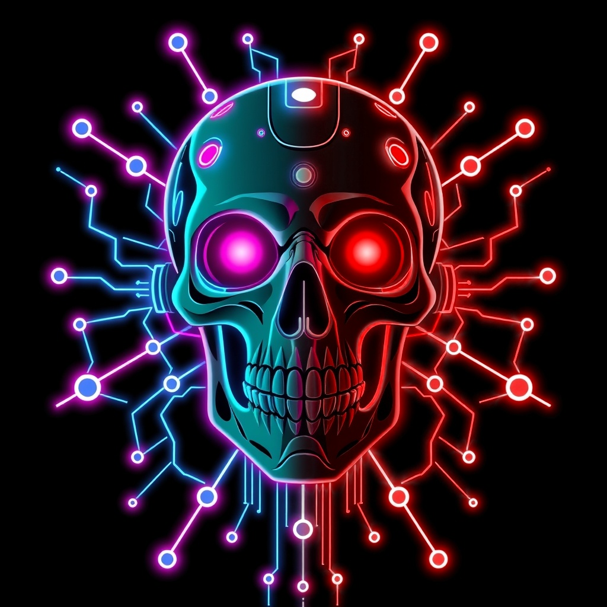
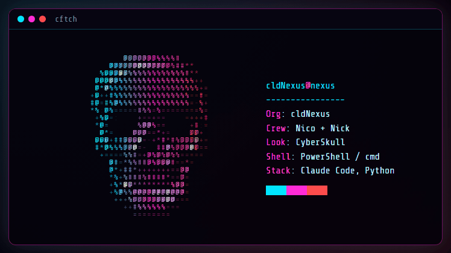

# cldNexus

**Cyberpunk-Tools, Games und Bots** von [Nico](https://github.com/cldNico) und [Nick](https://github.com/cldNiick).

`neon cyan` · `neon magenta` · `neon red`

[Website](https://cldnexus.github.io)

<b>cftch</b> · animierter 3D-Fetch für Windows · <i>bald verfügbar</i>

---

### Was wir bauen

- **Tools** für Terminal und Alltag, im CyberSkull-Look
- **Games** und Spielideen
- **Bots** und Automatisierung
- **Claude-Code-Skills**, die wir untereinander teilen

> Vieles entsteht zuerst in privaten Repos und wird veröffentlicht, wenn es reif ist.
